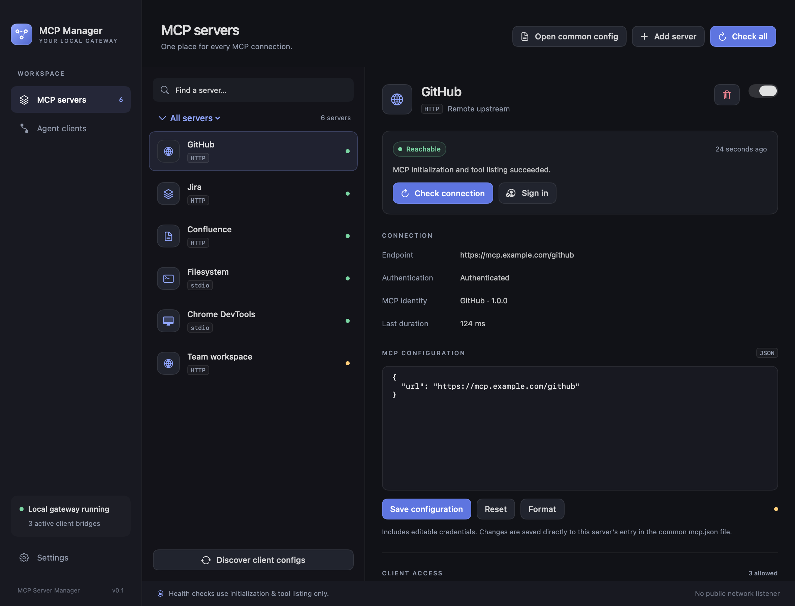
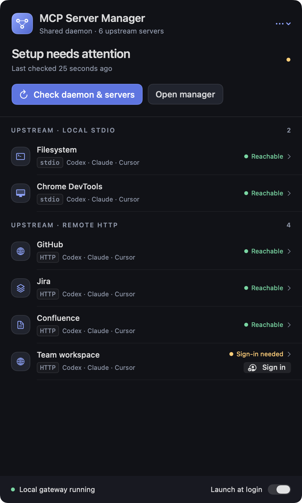

# MCP Server Manager

A central place to manage MCP servers on macOS. Configure your servers once and share them across Codex, Claude Desktop, Cursor, and VS Code through one local gateway.

- Manage local stdio and remote HTTP servers.
- Edit server configuration, sign in, and check connection status.
- Choose which clients can access each server and its tools.
- Keep connections handy from the menu bar, with optional startup at login.

## Screenshots

### Manager



### Menu bar



Screenshots use example server data.

## Build and run

Requires macOS 14+, the Swift command-line tools, and Python 3.11+.

```sh
./scripts/build-app.sh
open "build/MCP Server Manager.app"
```

Discover or add servers, then connect your apps from **Agent clients**. Restart each client after applying its bridge configuration.

The shared configuration lives at `~/Library/Application Support/MCP Server Manager/mcp.json`. Credentials are stored directly in each server entry with owner-only file permissions; Keychain is not used.

## Development

```sh
python3 -m unittest discover -s tests -v
./scripts/test-native.sh
python3 scripts/smoke.py
```

Regenerate the example screenshots with `./scripts/capture-screenshots.sh`.
